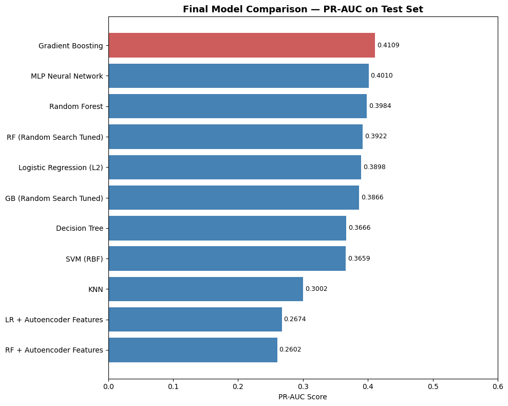
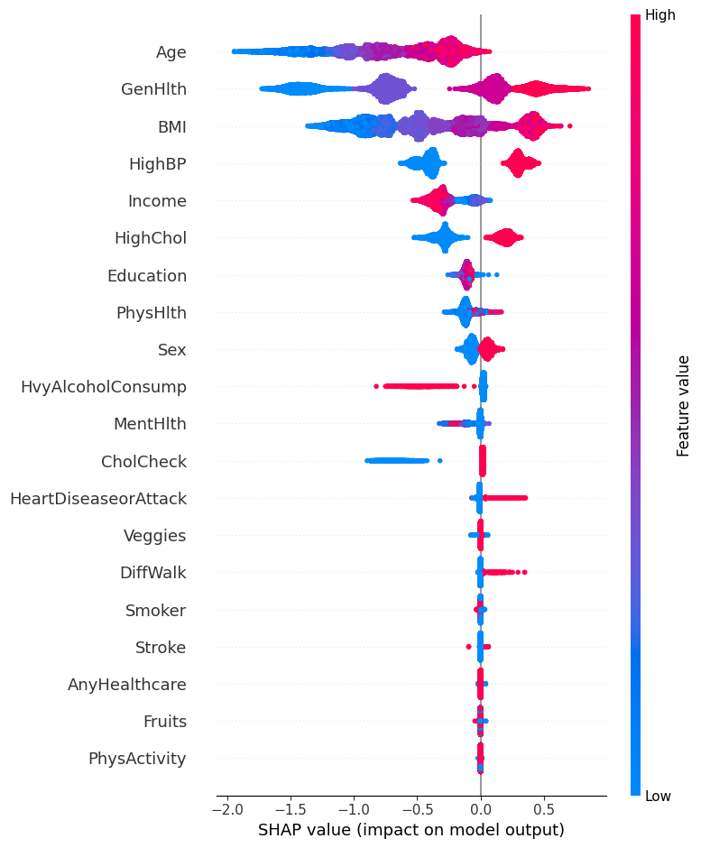
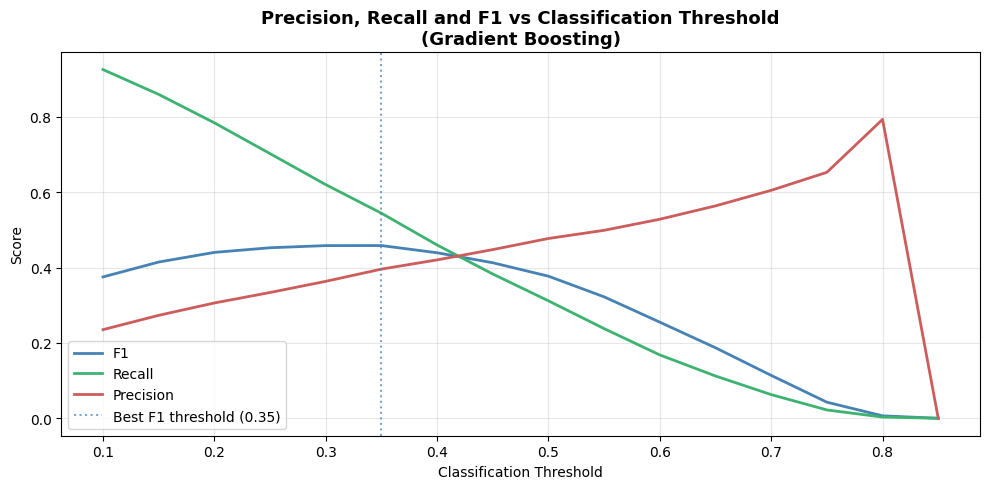

# Diabetes Risk Prediction from CDC Health Indicators

Can machine learning flag people at high risk of diabetes using only self-reported survey data, without blood tests? This project compares classical ML models and neural networks on the CDC Diabetes Health Indicators dataset (253,680 people, 21 features), with a focus on class imbalance, interpretability and fairness.

> MSc Business Administration and Data Science, Machine Learning and Deep Learning course project (Spring 2026). Team project by 4 students.

## Research question

**Which machine learning approaches can most reliably detect diabetes from imbalanced health survey data while staying clinically interpretable?**

## Key results

**Gradient Boosting was the best model**, with **PR-AUC 0.41** and **ROC-AUC 0.82** on the untouched test set. More complex models did not do better:



| Model | PR-AUC | ROC-AUC | Recall | Precision | F1 |
|---|---:|---:|---:|---:|---:|
| **Gradient Boosting** | **0.411** | **0.822** | 0.312 | 0.477 | 0.377 |
| MLP neural network | 0.401 | 0.820 | 0.809 | 0.290 | 0.427 |
| Random Forest | 0.398 | 0.819 | 0.555 | 0.385 | 0.454 |
| Logistic Regression (L2) | 0.390 | 0.819 | 0.761 | 0.312 | 0.443 |
| Decision Tree | 0.367 | 0.798 | 0.513 | 0.366 | 0.427 |
| SVM (RBF) | 0.366 | 0.808 | 0.759 | 0.308 | 0.439 |
| KNN | 0.300 | 0.761 | 0.711 | 0.272 | 0.393 |

*PR-AUC is the main metric because only 14% of people in the data have diabetes. Results are at the default 0.5 threshold.*

Other findings:
- **All models hit the same performance ceiling.** Tuning, a soft-voting ensemble, an MLP and autoencoder features did not get past it. The limit is in the data (class imbalance and no clinical biomarkers), not in model complexity.
- **Threshold tuning:** lowering Gradient Boosting's decision threshold from 0.5 to 0.3 roughly **doubles recall (31% → 62%)**, catching far more diabetic patients at the cost of more false alarms.
- **The strongest predictors are general health, BMI, age and high blood pressure** (SHAP, Random Forest importances and Logistic Regression coefficients all agree).
- **Error analysis and fairness:** the model most often misses diabetic patients who *look* healthier, with higher income, more education and more physical activity. Recall also differed across socioeconomic groups, which matters for any real screening tool.



## Data

[CDC Diabetes Health Indicators](https://archive.ics.uci.edu/dataset/891/cdc+diabetes+health+indicators) (UCI Machine Learning Repository, based on the CDC's BRFSS 2015 survey).
- 253,680 respondents, 21 features: health conditions (blood pressure, cholesterol, BMI, heart disease), lifestyle (smoking, activity, diet, alcohol), healthcare access, and demographics (age, sex, education, income).
- Binary target, `Diabetes_binary`: 86% no diabetes, 14% prediabetes or diabetes (6.2 : 1 imbalance).

The notebook downloads the dataset automatically with `ucimlrepo`, so no data file is stored in this repo.

## Methodology

1. **EDA:** class balance, feature distributions, correlations, risk ratios, and clinical, lifestyle and socioeconomic breakdowns.
2. **Preprocessing:** stratified 80/20 train/test split and standard scaling (fit on train only).
3. **Class imbalance:** SMOTE applied to the training set only; the test set keeps the real-world distribution.
4. **Baseline models:** Logistic Regression, KNN, Decision Tree, Random Forest, Gradient Boosting and SVM.
5. **Diagnostics and tuning:** learning curves, Random Search hyperparameter tuning, and regularisation of the overfitting Random Forest.
6. **Beyond classical ML:** soft-voting ensemble, MLP (Keras, with batch norm, dropout and class weights), and an autoencoder (21 → 4 dimensions) as a feature extractor.
7. **Evaluation:** PR-AUC (primary), ROC-AUC, recall, precision, F1, confusion matrices and cross-validation.
8. **Interpretability:** SHAP, feature importances and model coefficients.
9. **Responsible ML:** error analysis of missed patients, fairness checks across sex, age, income and education, and clinical threshold tuning.



## Repository structure

```
├── Diabetes_Risk_Prediction.ipynb   # full analysis (Python / Jupyter)
├── report/
│   └── Diabetes_Risk_Prediction_report.pdf
└── images/                          # figures used in this README
```

## How to run

The easiest way is to open the notebook in **Google Colab** and run all cells. Locally:

```bash
pip install ucimlrepo numpy pandas scikit-learn imbalanced-learn tensorflow shap matplotlib seaborn
jupyter notebook Diabetes_Risk_Prediction.ipynb
```

Some steps (Gradient Boosting, SVM, Random Search, cross-validation) take a few minutes each.

## Tech stack

Python · scikit-learn · imbalanced-learn (SMOTE) · TensorFlow/Keras · SHAP · pandas · NumPy · matplotlib · seaborn · Jupyter/Colab

## Team

This was a team project by four students, completed for the Machine Learning and Deep Learning course in the MSc Business Administration and Data Science programme (Spring 2026). The analysis, modelling and report were developed together as a group.

---
*Data: CDC Diabetes Health Indicators, UCI Machine Learning Repository (CC BY 4.0).*
